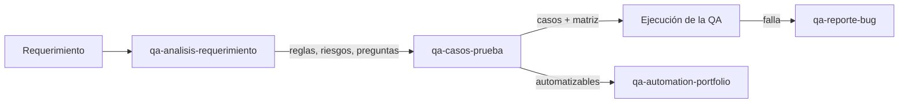

# QA Harness — método de QA para agentes de IA

Un conjunto de **skills** (instrucciones escritas) para que un agente de IA trabaje como QA
siguiendo un método, en lugar de improvisar: analiza el requerimiento, diseña casos de prueba y
reporta bugs, **sin inventar datos y dejando las decisiones a la QA**.

Funciona con Claude Code, Codex, Cursor y Antigravity. No necesita Jira ni ninguna cuenta: todo
queda en archivos Markdown dentro del repo.

---

## 🎯 Qué demuestra este repositorio

- **Método de QA:** análisis de requerimientos, técnicas de diseño de casos (partición de
  equivalencia, valores límite, casos negativos) y reporte de bugs reproducibles.
- **Trazabilidad:** cada caso apunta a una regla de negocio o a un riesgo, y la matriz de
  cobertura muestra lo que queda sin cubrir.
- **IA con control:** la IA propone y la QA decide. Lo que el requerimiento no dice se convierte
  en una pregunta para el equipo, nunca en una suposición.

## 🔄 Cómo funciona

| Skill | Recibe | Devuelve |
|---|---|---|
| [`qa-analisis-requerimiento`](skills/qa-analisis-requerimiento/SKILL.md) | Una historia de usuario o descripción funcional | Reglas de negocio, ambigüedades, riesgos, preguntas para el equipo y alcance |
| [`qa-casos-prueba`](skills/qa-casos-prueba/SKILL.md) | El análisis | Casos positivos, negativos y de borde, priorizados, con matriz de cobertura |
| [`qa-reporte-bug`](skills/qa-reporte-bug/SKILL.md) | Lo que observaste al probar | Un reporte reproducible, con severidad y prioridad por separado |

Todas las skills tienen la misma estructura: cuándo se usa · entrada · pasos · límites · cuándo
pide decisión humana · salida y criterio de terminado.

## 📂 Ejemplo resuelto: login de SauceDemo

En [`salidas/login-saucedemo/`](salidas/login-saucedemo/) está el resultado de correr las skills
sobre el login de [SauceDemo](https://www.saucedemo.com), un sitio público de práctica:

1. [Requerimiento](salidas/login-saucedemo/requerimiento.md): una historia de usuario de demo,
   escrita con huecos a propósito, como suelen llegar las reales.
2. [Análisis](salidas/login-saucedemo/analisis.md): 6 reglas de negocio, 7 ambigüedades
   (por ejemplo, "el login debe ser rápido" sin un número) y 8 preguntas para el equipo.
3. [Casos de prueba](salidas/login-saucedemo/casos.md): 12 casos. 4 quedan **bloqueados**
   porque dependen de preguntas sin responder: la skill no inventa el resultado esperado.

## 🚀 Cómo usarlo

1. Clona el repo y ábrelo con tu agente (Claude Code, Codex, Cursor o Antigravity).
2. Escribe `PING-HARNESS`. Si responde `PONG qa-harness skills:3`, está leyendo las reglas.
3. Pega un requerimiento y pide: *"analiza este requerimiento"*. Después: *"genera los casos"*.

Las reglas del agente están en [`AGENTS.md`](AGENTS.md).

## 🔗 Proyecto relacionado

Los casos marcados como automatizables se llevan a
[**qa-automation-portfolio**](https://github.com/SabrinaAlvarez25/qa-automation-portfolio):
Playwright + TypeScript, Page Object Model y CI con GitHub Actions.

## 🗺️ Próximos pasos

- [ ] Ejecutar los casos del ejemplo y documentar los bugs con `qa-reporte-bug`.
- [ ] Integración con Jira: leer los tickets y publicar los resultados desde el agente.

---

La idea de trabajar con un arnés de skills para QA la aprendí con la profesora Adriana Troche
Robles. Las skills, las reglas y el ejemplo de este repo son mi propia versión, más simple y sin
dependencias de herramientas de una empresa.

**Sabrina Alvarez** — QA Engineer · [GitHub](https://github.com/SabrinaAlvarez25)
